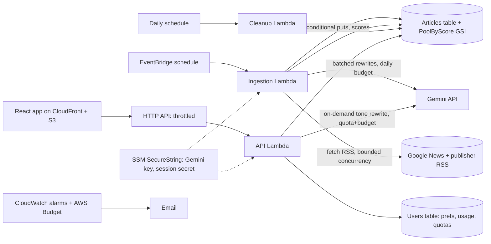

# Architecture

**Principles**: ingestion never depends on user traffic; users only read the shared pool; Gemini output is cached once per article+tone;
every external dependency can fail without breaking the feed.

## Code map (`backend/shared`)
`ingestion/` rss, dedupe, ranking, fetcher, og, pipeline · `briefing/` selection (pure), service (use-cases) · `ai/` gemini client, guardrails, personalities, headlines ·
`repositories/` dynamo + memory (identical semantics) · `config/` settings, categories, publishers, sources.json · `validation.py` · `secrets.py`.

## Ranking
score = 0.30 recency (12h half-life) + 0.20 publisher credibility + 0.20 cross-publisher coverage (distinct publishers, log-scaled) + 0.20 impact keywords + 0.10 category relevance.
Near-duplicate headlines (token Jaccard/overlap ≥ 0.6) merge into the most credible version; others become `alsoReportedBy`.

## Selection
Each active category gets its default slots (3/2/3/2); unfilled slots (muted or thin categories) go to the best remaining stories from any active category.
Fewer than 10 qualifying stories → fewer are returned with an explanation; nothing is fabricated.
